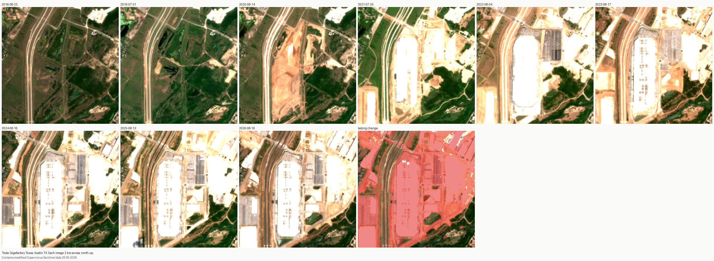

# Sites from orbit

Companies describe physical projects in their 10-Ks: a new fab, a battery plant, an LNG terminal. This part of Reed checks a handful of those descriptions against free satellite imagery and asks one narrow question: **when did lasting construction first show up from orbit, and does that fit what the filing says?**

It is descriptive and backward-looking. It says nothing about whether a project is on budget, says nothing about the companies' prospects, and gives no trading signal. It shares no code paths or data with any trading work, and nothing here feeds the daily Reed page.

## Results (v0, November 2026)

For all seven projects that started inside the imagery archive, lasting construction first shows in the same summer as the first 10-K that describes the project as committed or under construction, or the summer after. The eighth site, Plant Vogtle, is a control: its new units were built before 2018, so 10 m imagery shows no new ground work even though the 10-K reports them entering service in 2023 and 2024.

| Site | First 10-K describing the project | First lasting change in imagery | Share of site changed by 2026 |
| --- | --- | --- | --- |
| Tesla, Gigafactory Texas | FY2020 ("under construction") | Aug 2020 | 70% |
| Intel, Ohio fabs | FY2022 ("broke ground") | Aug 2022 | 69% |
| Texas Instruments, Sherman SM1/SM2 | FY2022 ("starting construction") | Aug 2022 | 43% |
| Ford, Tennessee EV and battery plants | FY2022 | Aug 2022 | 86% |
| GM, Ultium Cells Lordstown | FY2020 ("announced plans") | Aug 2020 | 26% |
| Eli Lilly, Lebanon IN | FY2022 ("committed to invest") | Aug 2023 | 60% |
| ExxonMobil, Golden Pass LNG | 2019 decision (10-K text not yet pulled) | Jun 2019 | 37% |
| Southern Co., Vogtle 3 and 4 (control) | FY2023 (units in service) | none | 11% |

Things the comparison surfaced:

- **Words lag the ground.** GM's FY2020 10-K only says it has "announced plans" to make cells in Lordstown, while the August 2020 image already shows the whole pad graded. Ford's 10-Ks never name BlueOval City; they describe "a new electric vehicle assembly plant" with Tennessee incentives.
- **Slowdowns don't show at 10 m.** Intel's FY2024 10-K says it has "slowed the completion" of the Ohio fab. From 2023 on the site changes only slowly, and nothing at 10 m separates a slowed build from an on-schedule one. Imagery can confirm a start; it cannot confirm pace.
- **Open vision models are hit and miss.** Shown only the dated images, Llama 4 Scout and Mistral Small 3.1 each matched the pixel measurement on 5 of 8 sites. Both called Vogtle "new construction in 2019", and Llama saw Intel's 2019 farm fields as cleared ground. Details in [`results/judge.md`](results/judge.md).

Image strips with the lasting change marked in red are in [`results/report.md`](results/report.md). The filing sentences behind each row are in [`results/filings.md`](results/filings.md).



## What it does

| Step | Script | Runs where |
| --- | --- | --- |
| 1. Claims | `sites/claims.json` | Hand-written: company, site, our one-line summary of the claim, the year the filing gives for the start of work, and the site's coordinates. |
| 2. Imagery | `sites/orbit.py` | Anywhere with Python. For each year from 2018, picks the clearest Sentinel-2 image in the summer months, measures change against the first year, and draws a strip of images. |
| 3. Filing check | `scripts/sites-filings.mjs` | GitHub Actions (needs SEC EDGAR). Pulls the sentences in each company's 10-Ks that name the site, so our summary can be checked against the filing's own words. |
| 4. Model check | `scripts/sites-judge.mjs` | GitHub Actions (needs Cloudflare). Shows open vision models on Workers AI the dated images only and asks when construction first appears. Scores them against the pixel measurement and the filing year. |

All four run from the "Sites from orbit" workflow (Actions tab, run by hand). Results land in `sites/results/` and in the run's artifact.

```
pip install -r sites/requirements.txt
python sites/orbit.py                         # all claims, ~1-3 minutes per site
python sites/orbit.py --only txn-sherman
python sites/orbit.py --locate 33.558,-96.615 --year 2025   # one wide image, to place a site
```

## Method

**Imagery.** Sentinel-2 Level-2A (surface reflectance, 10 m pixels), read directly from the public archive on AWS (`sentinel-cogs`, the Earth Search copy). The script lists scenes for the site's MGRS tile by month and reads only a small window around the site from each cloud-optimized GeoTIFF, so a site-year costs a few megabytes. No account, API key or STAC service is needed.

**Picking images.** For each year, scenes from June to September (wider for the Gulf Coast site, which is often cloudy) are checked nearest mid-season first. The scene classification band decides how much of the site is clear ground; the first scene with at least 98% clear is used, or the clearest one if none reaches that, and the year is skipped below 90%. Summer-to-summer comparisons keep crop and leaf cycles from looking like construction.

**Measuring change.** Each pixel is compared with the same pixel in the first year. It counts as changed when it became brighter in visible light by more than 0.05 reflectance (cleared soil, concrete, roofs) or lost more than 0.25 NDVI (paving, dark roofs). A changed pixel counts as **lasting** from year *t* only if it is still changed in every later clear year. Crop rotation and a dry summer come and go; graded pads and buildings stay. The **first lasting change** is the first year where at least 10% of the site box shows lasting change.

**Verdict.** 10-Ks rarely give a ground-breaking date, so `claim_year` is the fiscal year of the first 10-K in the set that describes the project as committed or under construction. We compare it with the year of first lasting change: *consistent* if within a year either way, otherwise *change visible earlier than stated* or *later than stated*. The latest image can't start a run of lasting change, since no later look confirms it. If nothing lasting shows, the verdict says so.

**Sites.** Each site is a square 1.6 to 2.4 km across, centered by eye on the construction area in a recent image. The coordinates are ours, not the companies'; check the image strip before relying on a site.

## Limits

- 10 m pixels show ground clearing, pads, large roofs and tanks. They do not show what is inside a building, whether equipment is installed, or whether a plant is producing. "Construction visible" is the most this can say, and the Vogtle row is there to show it.
- The run starts in 2018 (the archive goes back to 2017 in most places). Anything begun earlier has no "before" image.
- A site box can include neighbors' construction (Austin and Sherman both have other projects next door).
- Our claim summaries are short paraphrases. Read the filing sentences in `sites/results/filings.md` before quoting a company.
- Eight sites is a demonstration, not a sample. Thresholds were set by looking at these sites, so they are not tested out of sample.

## Licensing and credit

Sentinel-2 data is provided free under the Copernicus Sentinel data terms (EU Regulation 1159/2013 and the Sentinel data legal notice): reproduction, distribution, adaptation and public display are allowed, including commercially, provided the source is credited. Every image here is cropped and color-stretched, so the credit is **"Contains modified Copernicus Sentinel data [years]"**, which `orbit.py` writes on each image. Keep that line on any image published on muscoota.com or elsewhere.

Not used here, on purpose: Google, Esri, Mapbox and Bing imagery (their terms forbid extracting imagery), the EOX Sentinel-2 cloudless mosaics after 2016 (CC BY-NC-SA, no paid use), and commercial imagery (Planet, Maxar), whose licenses restrict redistribution. NAIP (USDA, public domain, about 1 m) and Landsat (USGS, public domain) are good next sources; NAIP would show much more detail for US sites but is flown only every two to three years per state.
