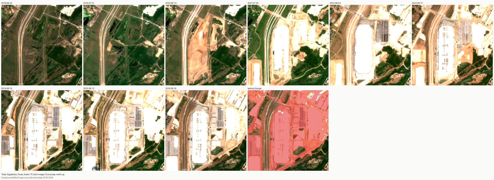
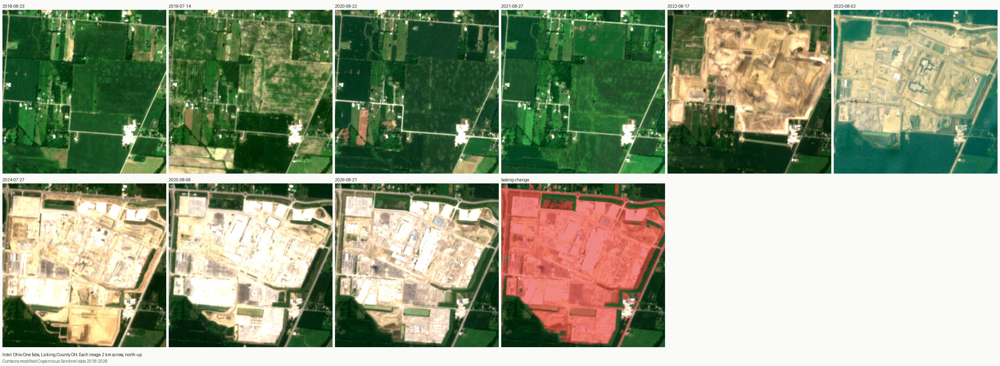
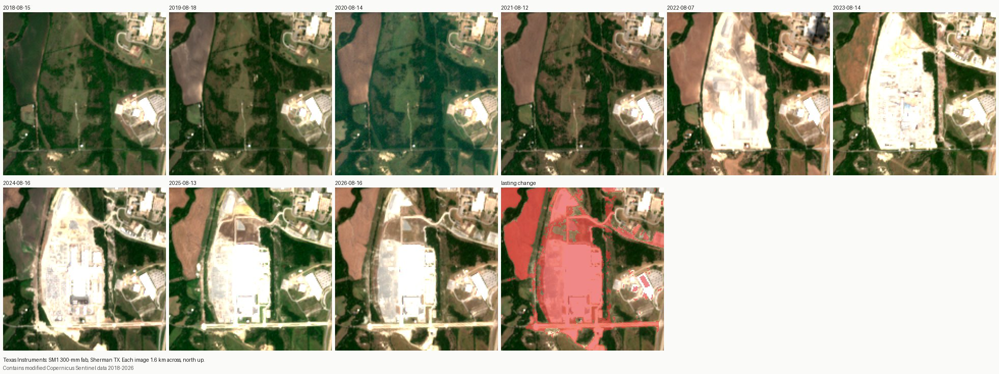
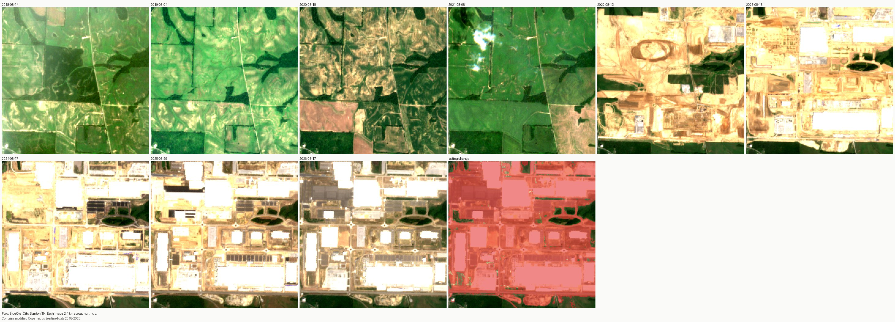
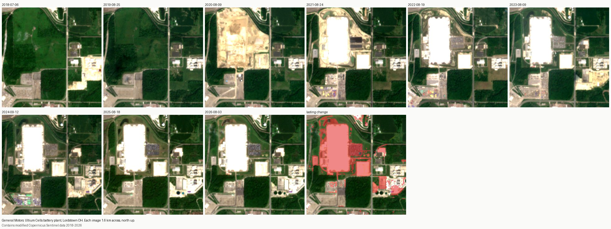
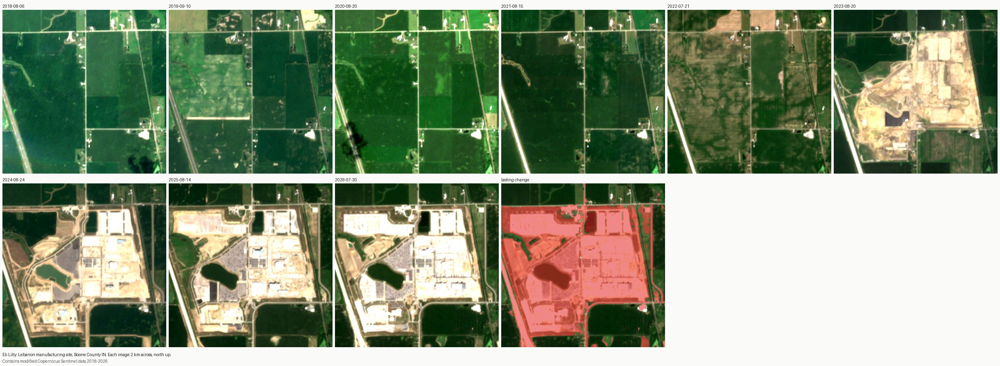
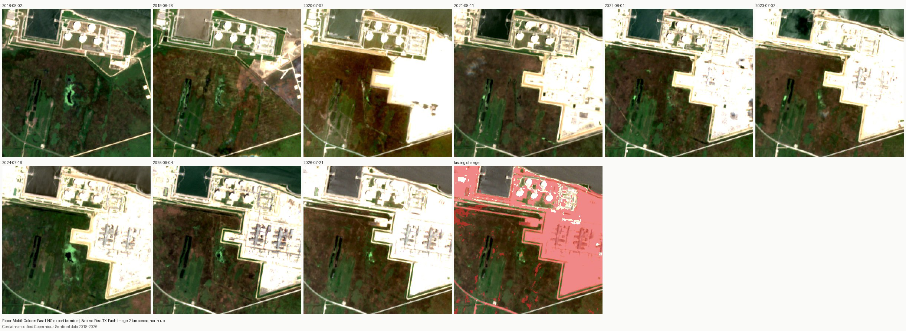
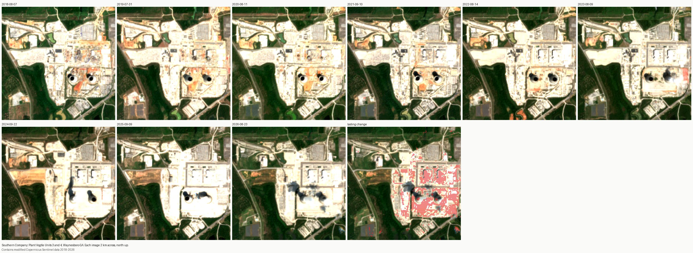

# Sites from orbit: results

Generated by `sites/orbit.py`. Contains modified Copernicus Sentinel data.

| Site | Filing says | First lasting change seen | Verdict |
| --- | --- | --- | --- |
| Tesla: Gigafactory Texas, Austin TX | FY2020 10-K: Gigafactory Texas in Austin is under construction; FY2021 10-K: it will begin production in 2022. | 2020-08-14 | consistent |
| Intel: Ohio One fabs, Licking County OH | FY2022 10-K: Intel broke ground on two new leading-edge chip factories in Ohio. FY2024 10-K: completion of the Ohio facility has been slowed. | 2022-08-17 | consistent |
| Texas Instruments: SM1 300-mm fab, Sherman TX | FY2022 10-K: TI started construction on SM1 and SM2 in Sherman, Texas. FY2024 10-K: equipping SM1, still building SM2. | 2022-08-07 | consistent |
| Ford: BlueOval City, Stanton TN | FY2022 10-K: Tennessee incentives for Ford's new EV assembly plant, and BlueOval SK battery plants in Tennessee that the joint venture will build. FY2024: the joint venture is building them. (The 10-Ks do not use the name BlueOval City.) | 2022-08-13 | consistent |
| General Motors: Ultium Cells battery plant, Lordstown OH | FY2020 10-K: GM has announced plans to mass-produce battery cells at Ultium Cells LLC in Lordstown, Ohio. Later 10-Ks give the location as Warren, Ohio. | 2020-08-09 | consistent |
| Eli Lilly: Lebanon manufacturing site, Boone County IN | FY2022 10-K: Lilly committed more than $2 billion to two new manufacturing facilities in Lebanon, Indiana. Later 10-Ks say only 'new facilities in Indiana'. | 2023-08-20 | consistent |
| ExxonMobil: Golden Pass LNG export terminal, Sabine Pass TX | Golden Pass LNG (ExxonMobil joint venture) took its investment decision in 2019 and is adding liquefaction trains at the existing import terminal. Not yet checked against the 10-K text: the filing step could not find ExxonMobil's 10-Ks in the SEC feed. | 2019-06-28 | consistent |
| Southern Company: Plant Vogtle Units 3 and 4, Waynesboro GA | FY2023 10-K: Georgia Power placed Plant Vogtle Units 3 and 4 in service on July 31, 2023 and April 29, 2024. Construction began about 2013, before this archive, so this site is a control: it shows what 10 m imagery cannot see. | none | control: work began before the archive |

## Per year

### Tesla: Gigafactory Texas, Austin TX

| Image date | Clear | Changed vs first year | Lasting change |
| --- | --- | --- | --- |
| 2018-08-23 | 100% | 0% | 0% |
| 2019-07-31 | 100% | 6% | 2% |
| 2020-08-14 | 100% | 31% | 24% |
| 2021-07-25 | 100% | 55% | 48% |
| 2022-08-04 | 100% | 74% | 54% |
| 2023-08-17 | 100% | 72% | 59% |
| 2024-08-16 | 100% | 68% | 61% |
| 2025-08-13 | 100% | 72% | 65% |
| 2026-08-16 | 100% | 70% | 70% |

### Intel: Ohio One fabs, Licking County OH

| Image date | Clear | Changed vs first year | Lasting change |
| --- | --- | --- | --- |
| 2018-08-23 | 100% | 0% | 0% |
| 2019-07-14 | 100% | 18% | 0% |
| 2020-08-22 | 100% | 3% | 0% |
| 2021-08-27 | 100% | 0% | 0% |
| 2022-08-17 | 100% | 54% | 48% |
| 2023-08-02 | 100% | 98% | 65% |
| 2024-07-27 | 100% | 74% | 66% |
| 2025-08-06 | 100% | 68% | 66% |
| 2026-08-21 | 100% | 69% | 69% |

### Texas Instruments: SM1 300-mm fab, Sherman TX

| Image date | Clear | Changed vs first year | Lasting change |
| --- | --- | --- | --- |
| 2018-08-15 | 100% | 0% | 0% |
| 2019-08-18 | 100% | 10% | 3% |
| 2020-08-14 | 100% | 11% | 3% |
| 2021-08-12 | 100% | 10% | 3% |
| 2022-08-07 | 100% | 42% | 28% |
| 2023-08-14 | 100% | 41% | 30% |
| 2024-08-16 | 100% | 45% | 36% |
| 2025-08-13 | 100% | 43% | 40% |
| 2026-08-16 | 100% | 43% | 43% |

### Ford: BlueOval City, Stanton TN

| Image date | Clear | Changed vs first year | Lasting change |
| --- | --- | --- | --- |
| 2018-08-14 | 100% | 0% | 0% |
| 2019-08-04 | 100% | 0% | 0% |
| 2020-08-18 | 100% | 9% | 0% |
| 2021-08-08 | 100% | 6% | 5% |
| 2022-08-13 | 100% | 77% | 73% |
| 2023-08-18 | 100% | 90% | 84% |
| 2024-08-17 | 100% | 90% | 85% |
| 2025-08-29 | 100% | 90% | 86% |
| 2026-08-17 | 100% | 86% | 86% |

### General Motors: Ultium Cells battery plant, Lordstown OH

| Image date | Clear | Changed vs first year | Lasting change |
| --- | --- | --- | --- |
| 2018-07-06 | 100% | 0% | 0% |
| 2019-08-25 | 100% | 0% | 0% |
| 2020-08-09 | 100% | 29% | 18% |
| 2021-08-24 | 100% | 32% | 18% |
| 2022-08-19 | 99% | 20% | 18% |
| 2023-08-09 | 100% | 30% | 23% |
| 2024-09-12 | 100% | 28% | 23% |
| 2025-08-18 | 100% | 31% | 25% |
| 2026-08-03 | 100% | 26% | 26% |

### Eli Lilly: Lebanon manufacturing site, Boone County IN

| Image date | Clear | Changed vs first year | Lasting change |
| --- | --- | --- | --- |
| 2018-08-06 | 100% | 0% | 0% |
| 2019-09-10 | 100% | 10% | 0% |
| 2020-08-20 | 100% | 0% | 0% |
| 2021-08-15 | 100% | 1% | 1% |
| 2022-07-21 | 100% | 18% | 8% |
| 2023-08-20 | 100% | 48% | 44% |
| 2024-08-24 | 100% | 55% | 50% |
| 2025-08-14 | 100% | 59% | 57% |
| 2026-07-30 | 100% | 60% | 60% |

### ExxonMobil: Golden Pass LNG export terminal, Sabine Pass TX

| Image date | Clear | Changed vs first year | Lasting change |
| --- | --- | --- | --- |
| 2018-08-02 | 100% | 0% | 0% |
| 2019-06-28 | 100% | 22% | 11% |
| 2020-07-02 | 100% | 32% | 22% |
| 2021-08-11 | 100% | 36% | 24% |
| 2022-08-01 | 100% | 27% | 25% |
| 2023-07-02 | 100% | 48% | 29% |
| 2024-07-16 | 100% | 35% | 29% |
| 2025-09-04 | 100% | 38% | 31% |
| 2026-07-21 | 100% | 37% | 37% |

### Southern Company: Plant Vogtle Units 3 and 4, Waynesboro GA

| Image date | Clear | Changed vs first year | Lasting change |
| --- | --- | --- | --- |
| 2018-08-07 | 100% | 0% | 0% |
| 2019-07-31 | 100% | 13% | 1% |
| 2020-08-11 | 100% | 11% | 2% |
| 2021-09-10 | 100% | 7% | 2% |
| 2022-08-14 | 100% | 11% | 4% |
| 2023-08-09 | 99% | 9% | 5% |
| 2024-09-22 | 100% | 16% | 8% |
| 2025-09-09 | 100% | 18% | 10% |
| 2026-08-23 | 100% | 11% | 11% |
